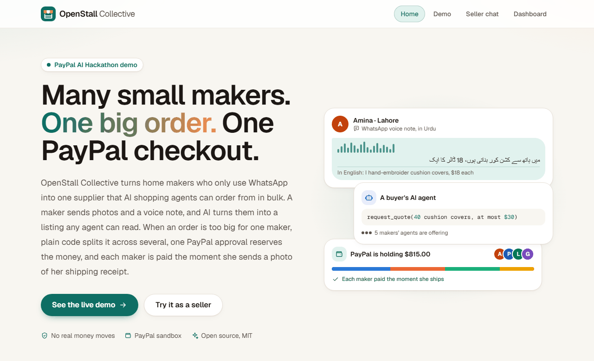
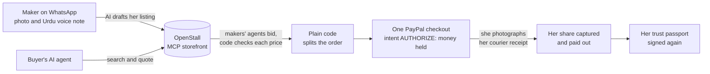
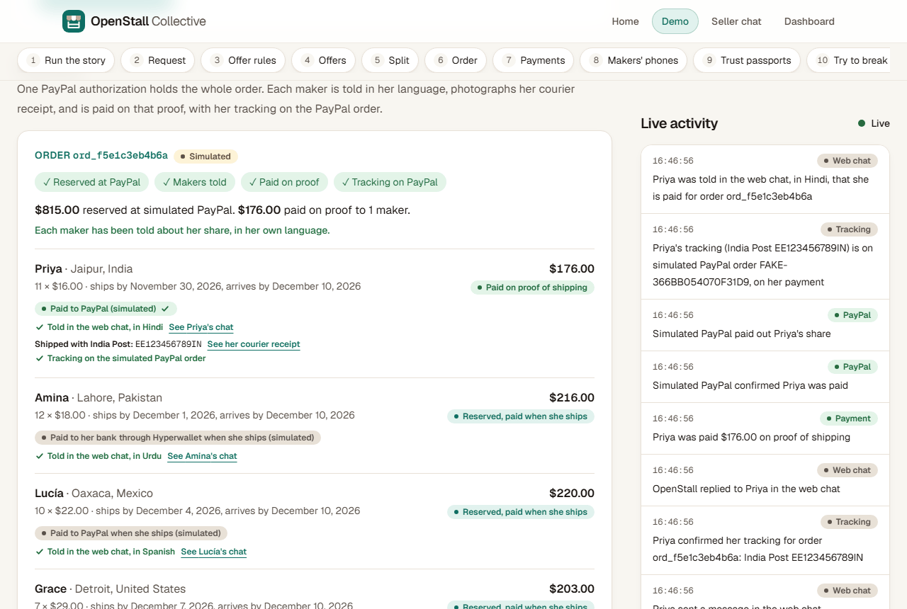
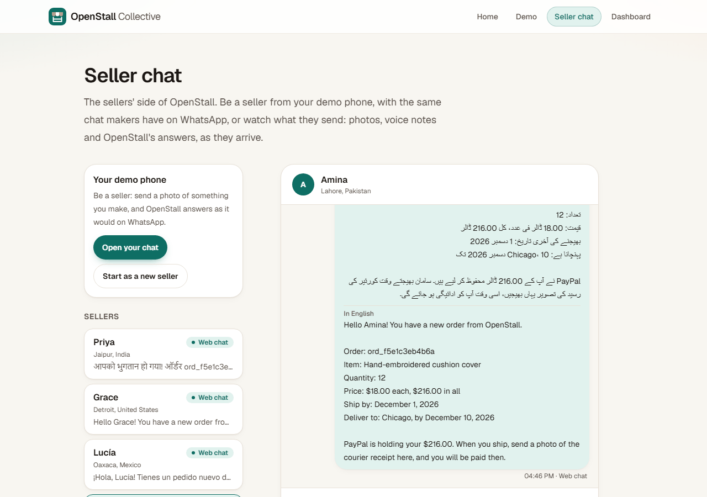
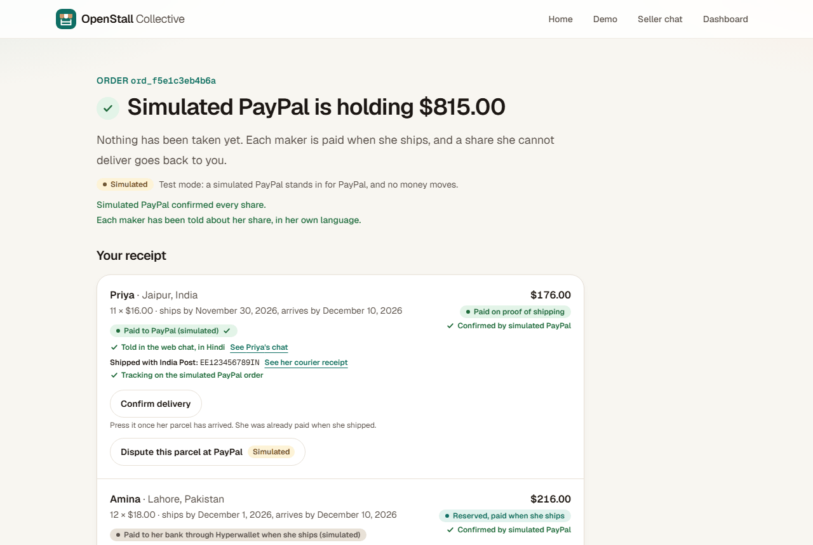
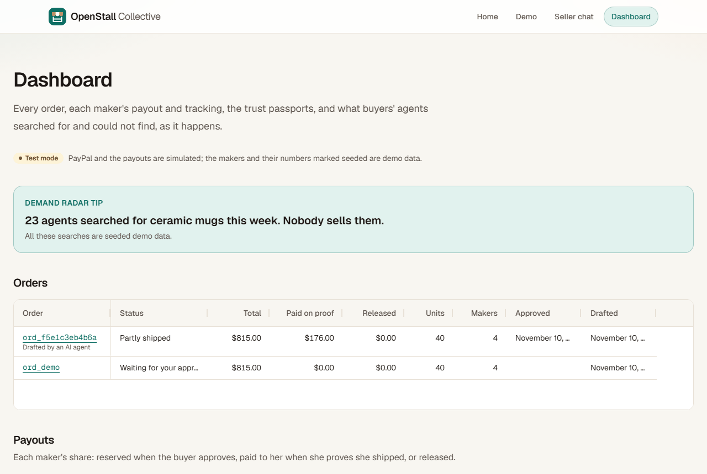

<p align="center">
  
</p>

<h1 align="center">OpenStall Collective</h1>

<p align="center">
  <strong>WhatsApp makers become one supplier that AI shopping agents can buy from,<br>
  and PayPal pays each maker the moment she proves she shipped.</strong>
</p>

<p align="center">
  
  
  
  
  
  
</p>

<p align="center">
  <a href="#try-it-for-judges"><b>Try it</b></a> ·
  <a href="https://www.youtube.com/watch?v=zbl8VqHXcYc"><b>Video (2:51)</b></a> ·
  <a href="#how-it-works">How it works</a> ·
  <a href="docs/judges.md">Judges' walkthrough</a> ·
  <a href="docs/guide.md">Detailed guide</a>
</p>



## Why

Where we live, in Pakistan, a huge number of small businesses run entirely on WhatsApp. Shopping is moving to AI agents, and those agents only buy from big stores with clean catalogs and checkout APIs. On her own, a home maker cannot take a 40-unit order, bargain with an AI buyer, or ask a stranger to trust her with the money first. **OpenStall lets the smallest sellers join the agent economy together, as one supplier, and be paid the moment they ship.**

## What it does

- **A stall from a chat.** A maker sends a photo and an Urdu voice note on WhatsApp. AI drafts her listing, asks one short question at a time in her language, and publishes it on her "ہاں" (yes).
- **AI agents buy through MCP.** A buyer's agent searches OpenStall's MCP storefront, reads each maker's signed trust passport, and asks for 40 cushion covers at most $30 each.
- **Makers' agents bid, code keeps the limits.** Each maker's AI agent offers a price; code checks it against her floor and the buyer's maximum, so no clever wording can talk a price lower.
- **One PayPal approval, paid on proof.** Plain code splits the order across makers. One PayPal checkout only *reserves* the money; each maker's share is captured the moment she photographs her courier receipt, and paid out on her rail.
- **It heals and it learns.** A maker who drops out is released, never charged, and the others are asked for her units. Every delivery re-signs her trust passport, and searches that found nothing become tips (Demand Radar).

## How it works



1. **List:** her photos and voice note (heard by ElevenLabs Scribe, read by Claude) become a listing; her own words back every number.
2. **Ask:** a buyer's AI agent calls the MCP storefront's tools: search, trust cards, `request_quote`. No tool can move money.
3. **Negotiate:** each maker's agent bids within her limits, up to three rounds; a refused price goes back with the reason.
4. **Split and approve:** the cheapest valid offers fill the order (12 / 11 / 10 / 7 for $815.00), explained in plain words, and a person approves one PayPal order that only holds the money.
5. **Pay on proof:** each maker is told in her language, sends her courier receipt, confirms the tracking number, and is paid from the one authorization, with her tracking on the PayPal order.
6. **Trust:** every delivery updates her Ed25519-signed trust passport, which any agent can check.

## See it

**The demo video, 2:51:** https://www.youtube.com/watch?v=zbl8VqHXcYc ([how it was made](video/README.md)). **A real WhatsApp chat on the hosted demo:** [a maker sends Start and gets OpenStall's welcome in Urdu, delivered and read](https://openstall-collective.onrender.com/seller-chat?seller=s_53a82b0aeae3).

| The live demo | A maker's chat: Urdu, with English under it |
| --- | --- |
|  |  |
| **PayPal holds the money** | **The dashboard, in AG Grid** |
|  |  |

## Try it (for judges)

**The hosted demo, on PayPal's sandbox:** https://openstall-collective.onrender.com. Claude, ElevenLabs and WhatsApp run for real there, and no real money moves. **Or run it on your machine in test mode**, with no keys and no accounts: test mode simulates PayPal, WhatsApp and the AI models, the same on every run, and every page says so.

### Try the hosted demo

1. On [/demo](https://openstall-collective.onrender.com/demo), press **Run it with an AI agent**: Claude, as a buyer's agent, chooses the MCP storefront's tools itself, and each maker's agent bids within her limits. The demo's buttons ask for the demo token, which is in the Devpost testing instructions with the PayPal sandbox buyer login.
2. **Open its approval page**, press **Approve and pay with PayPal**, and log in at PayPal's sandbox with that buyer login. The receipt says PayPal is holding the total, and each maker is told in her language.
3. **Be a maker on WhatsApp:** open [wa.me/923275157727?text=Start](https://wa.me/923275157727?text=Start), send the **Start** it writes for you, then a photo of something you make. OpenStall asks for what it needs, one question at a time, and your stall goes live. Everything on [/seller-chat](https://openstall-collective.onrender.com/seller-chat) is public, so send nothing private. If WhatsApp does not answer, **Start as a new seller** on [/seller-chat](https://openstall-collective.onrender.com/seller-chat) is the same chat in the browser.
4. [/status](https://openstall-collective.onrender.com/status) shows what runs for real, and the PayPal doctor's checks.

The seeded makers have no phones, so nobody can send their courier receipts on the hosted demo: play pay-on-proof in test mode, below.

### Run it in test mode (about five minutes)

You need Python 3.11 or newer, Node 24.15 or newer (or 26; not 25), and git. In a terminal:

```bash
git clone https://github.com/FahadRamxan/OpenStall-Collective.git
cd OpenStall-Collective
python -m venv .venv
source .venv/bin/activate
pip install -e ".[dev]"
cp .env.example .env
python scripts/seed_demo.py --reset --with-amina --demo-order
uvicorn openstall_api.main:app --port 8000
```

On Windows PowerShell, activate the virtual environment with `.venv\Scripts\Activate.ps1` and copy the settings with `copy .env.example .env`. Leave the API running, and in a second terminal, from the same folder:

```bash
cd apps/web
npm ci
npm run dev
```

Then open **http://localhost:3000/demo**.

### Walk the story

[docs/judges.md](docs/judges.md) walks you through every step, with what you should see. In short, on `/demo`:

1. **Run the demo request.** A buyer agent asks for 40 cushion covers; five makers' agents bid; code refuses two prices over the buyer's maximum; the order is split across four makers, $815.00.
2. **Open its approval page** and approve on the simulated PayPal page. PayPal only holds the $815.00.
3. **Back on `/demo`,** each maker's phone shows her order in her own language: Urdu, Hindi, Spanish, English, each with its English under it.
4. **Play Priya from her phone:** send her courier receipt, then reply "हाँ". Her share is captured and paid, and her tracking goes on the PayPal order.

The same walkthrough runs as a browser test on every change. To plug in your own AI agent, or run it against PayPal's real sandbox, see [the detailed guide](docs/guide.md#use-your-own-ai-agent).

## Built with

| Part | What it uses |
| --- | --- |
| **PayPal** | Orders v2 with intent AUTHORIZE, partial captures and voids, Payouts, order tracking, verified webhooks, disputes answered with proof, JS SDK buttons and Venmo, and PayPal's own MCP server for the ops agent |
| **APIMatic** | APIMatic's PayPal Python SDK for every Orders and Payments call, built with APIMatic's PayPal Context Plugin ([docs/apimatic.md](docs/apimatic.md)) |
| **AI** | Claude for the seller and buyer agents, the listing and receipt readers and the ops agent; ElevenLabs Scribe v2 for voice notes and Eleven v4 Turbo for spoken answers |
| **Channels** | WhatsApp through Whapi.Cloud on the hosted demo (Meta's WhatsApp Cloud API and Twilio also work), and the same chat in the browser |
| **Hosting** | Render: the API, the web app and Postgres from one blueprint ([render.yaml](render.yaml)) |
| **App** | Python, FastAPI, SQLAlchemy and Postgres; Next.js 16, React 19, Tailwind 4 and AG Grid; the MCP Python SDK |
| **Trust** | Ed25519-signed trust passports, checked live in the browser with Web Crypto |
| **Quality** | About 1,690 Python tests, 335 component tests and 119 browser tests, including an accessibility check of every page in light and dark mode |

**Where code decides, not the model:** every price against her limits, the split, every number in a sentence a model writes, every message to a maker (templates in her language), and every movement of money.

## Learn more

- **[The detailed guide](docs/guide.md):** everything that works, feature by feature; every PayPal product and how far it has got; what is simulated; running on PayPal's sandbox; the checks; hosting; build progress.
- **[The judges' walkthrough](docs/judges.md):** the story, step by step.
- **[APIMatic's PayPal SDK, operation by operation](docs/apimatic.md)**, and **[the sandbox proof](docs/day-one-checks.md)**.
- **[Why things are the way they are](docs/decisions.md)**, newest last.
- **[The demo video](video/README.md):** its script and voice, the screen recordings, and the studio that renders it at 60 fps.

## License

MIT. See [LICENSE](LICENSE).
